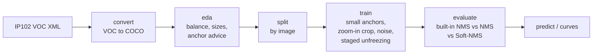

# Tiny Pest Detection

**Detecting small insect pests on the IP102 benchmark: VOC to COCO conversion, data-driven anchor sizing, small-anchor Faster / Mask R-CNN, and Soft-NMS for clustered insects.**


Off-the-shelf detectors miss small objects for a mechanical reason: their smallest anchor box is 32 pixels, so a 10-pixel insect never overlaps an anchor well enough to be proposed. Clustered insects add a second failure: standard non-maximum suppression deletes a real neighbour because its box overlaps the first one.

This project addresses both, and adds a step most tutorials skip: **measure the object sizes first**, because the right anchors depend on the data, not on the assumption that pests are tiny.

It is the production-grade rebuild of my M.Sc. Data Analytics coursework (BSBI Berlin, module *Computer Vision and Artificial Intelligence*, February 2025). See [What changed from the coursework](#what-changed-from-the-coursework).

---

## Pipeline



| Step | Module | What it does |
|---|---|---|
| Convert | `tinypest.voc` | Parses VOC XML with clear errors per file, maps IP102's numeric labels to class names, clips boxes to the image, assigns stable sequential ids. `--lenient` skips bad files and lists them. |
| Analyse | `tinypest.eda` | Class balance and imbalance ratio, image sizes, objects per image, object size relative to the image, COCO size buckets, and **anchor sizes fitted to the object sizes the model will actually see** after its resize. Saves two charts. |
| Augment | `tinypest.transforms` | Zoom-in crop that keeps objects (enlarges small ones), horizontal flip, brightness/contrast, Gaussian sensor noise. Boxes, labels and masks move together; objects cut away by a crop are removed. |
| Model | `tinypest.model` | ResNet-50-FPN Faster R-CNN (boxes) or Mask R-CNN (boxes + masks), COCO weights, anchors configurable per FPN level (default 8 to 128 px), progressive backbone unfreezing (`--unfreeze 1:2,4:3,7:5`). |
| Post-process | `tinypest.postprocess` | Class-wise NMS and Soft-NMS (Gaussian or linear decay). The model's built-in NMS is switched off when an external method is chosen, so the comparison is fair. |
| Evaluate | `tinypest.metrics` | Precision, recall and F1 at IoU 0.5 with class-aware greedy matching; COCO AP, AP50, AP75, **AP_small**, AP_medium, AP_large and AR via pycocotools. `--compare` runs all three post-processing settings in one go. |

## Measure before you shrink the anchors

Running `tinypest eda` on the 200-image IP102 detection subset used in the coursework gave this:

| Measure | Value |
|---|---|
| Images / boxes | 200 / 221 |
| Classes present | 2 of 102 (rice leaf roller 190, rice leaf caterpillar 31) |
| Imbalance ratio | 6.1 : 1 |
| Image width (median, range) | 386 px (140 to 3,072) |
| Box side relative to image side (median) | 0.62 |
| COCO size buckets (small / medium / large) | **0 / 8 / 213** |
| Box side after the model's resize (5th / 50th / 95th percentile) | 350 / 571 / 801 px |

**None of the 221 boxes is small.** IP102 images are mostly close-ups in which the insect fills the frame. The coursework set 16 px anchors for "tiny objects" without checking this; on this subset that only adds anchors that never match. The `eda` command now makes the check explicit and, for this data, advises anchors of 64 to 1,024 px, close to torchvision's default.

The small-anchor configuration is still the right tool for field images where pests are a few pixels across (traps, drone and wide-angle shots). The test suite exercises that case with synthetic 6 to 14 px insects, where the advice drops to 8 px anchors and coverage rises above 90%.

The second finding is class imbalance: with 190 versus 31 boxes, overall metrics are dominated by one class. Report per-class AP, or rebalance with targeted augmentation, before drawing conclusions.

## Quick start

```bash
git clone https://github.com/pankaj-chaubay/tiny-pest-detection.git
cd tiny-pest-detection
python -m venv .venv && source .venv/bin/activate     # Windows: .venv\Scripts\activate
pip install -e ".[dev]"
```

Get IP102 (see [data/README.md](data/README.md)), then:

```bash
# 1. VOC XML -> COCO (IP102 labels are 0-based indices into the class list)
tinypest convert path/to/Annotations --classes data/ip102_classes.txt --out data/coco/all.json

# 2. Look at the data and get anchor advice for your training resolution
tinypest eda data/coco/all.json --out-dir outputs/eda --min-size 800

# 3. Split by image
tinypest split data/coco/all.json --out-dir data/splits

# 4. Train (GPU recommended). Use the anchors that step 2 advised.
tinypest train --train data/splits/train.json --val data/splits/val.json \
               --images path/to/JPEGImages --out outputs/run \
               --anchors 8 16 32 64 128 --unfreeze 1:2,4:3,7:5 --epochs 12

# 5. Compare post-processing on the test split
tinypest evaluate data/splits/test.json --images path/to/JPEGImages \
                  --checkpoint outputs/run/best.pt --compare --out outputs/test_report.json

# 6. Loss curves and predictions
tinypest curves outputs/run/history.csv --out outputs/loss_curves.png
tinypest predict path/to/JPEGImages/IP000000002.jpg --checkpoint outputs/run/best.pt
```

Each command has `--help`. Expected problems (a missing file, a bad XML, an unknown class, an image whose size disagrees with its annotation) stop with a one-line message and exit code 2.

## Design choices

**Faster R-CNN by default, Mask R-CNN on request.** IP102 has boxes only. Training a mask head on box-shaped "masks" teaches it to draw rectangles, which adds cost and no information. `--arch maskrcnn` is there for data with real outlines (for example the polygons in my [paddy-pest-segmentation](https://github.com/pankaj-chaubay/paddy-pest-segmentation) project).

**Anchors that keep the pretrained RPN.** Changing anchor *sizes* while keeping three aspect ratios per location keeps the region proposal head's shape, so its COCO weights still load. Only the geometry changes.

**Soft-NMS for clusters.** Two neighbouring insects can overlap with IoU above 0.4. Hard NMS at 0.3 deletes one; Soft-NMS lowers its score instead and lets the final threshold decide. A unit test pins this behaviour.

**Staged unfreezing.** New heads start random. Training them first with most of the backbone frozen, then opening lower ResNet stages, avoids large early gradients overwriting useful pretrained features.

## Project layout

```
src/tinypest/
  voc.py          VOC XML parsing and VOC -> COCO conversion
  coco.py         COCO loading, validation, summary, split
  eda.py          dataset analysis and anchor advice
  transforms.py   zoom-in crop, Gaussian noise, joint box/mask augmentation
  dataset.py      COCO -> detector targets
  model.py        small-anchor Faster/Mask R-CNN, staged unfreezing
  postprocess.py  class-wise NMS and Soft-NMS
  engine.py       training, validation loss, inference, checkpoints
  metrics.py      P/R/F1 and COCO mAP by object size
  visualize.py    drawing helpers
  cli.py          the tinypest command
tests/            37 tests on synthetic IP102-style data; no download or GPU needed
data/             IP102 class list and download notes
docs/             review of the original coursework code
```

## Quality checks

```bash
pytest                          # 37 tests, under a minute on a laptop CPU
ruff check src tests && ruff format --check src tests
mypy                            # strict
```

The suite generates small images with tiny "pests" and matching VOC XML (numeric labels, one box past the image edge, one empty image), then covers parsing errors, label resolution, conversion, anchor advice, augmentation consistency, NMS and Soft-NMS behaviour, unfreezing, a perfect-prediction mAP of 1.0, and a full CLI run: convert, eda, split, train, evaluate `--compare`, predict and curves. GitHub Actions runs it on every push.

## What changed from the coursework

The original was a set of Colab notebooks. A full review is in [docs/coursework_review.md](docs/coursework_review.md).

| Coursework | This repository |
|---|---|
| Image ids from an MD5 hash modulo 10^9 (collisions possible) | Sequential ids in file-name order |
| `num_classes` used inside the dataset before it was defined; class labels outside the range silently set to background | Labels resolved and validated during conversion; unknown classes are an error |
| Masks built from lists of NumPy arrays (slow, warned) and from box rectangles while training Mask R-CNN | Faster R-CNN for box data; Mask R-CNN only with real masks |
| "Tiny object" anchors set without looking at object sizes | `eda` measures sizes after resize and advises anchors |
| Augmentation shown on one image, not used in training | Zoom-in crop, flip, colour and noise in the training pipeline |
| NMS written, Soft-NMS and staged unfreezing described only | Both implemented, configurable and tested |
| One epoch logged, no metrics reported | Validation loss, best checkpoint, loss curves, P/R/F1 and COCO mAP by size |
| Colab and Drive paths, `pip install` inside the code | Installable package and CLI, CI on GitHub Actions |

## Limitations

- **No trained results are published yet.** The coursework training ran in a shared Colab session and the weights were not kept. The commands above reproduce training on a GPU; results will be added here.
- The 200-image subset has two classes and no small objects, so it is a functional test, not a tiny-object benchmark. The full IP102 detection set (18,975 images) is the next step.
- Soft-NMS is written in plain PyTorch with a Python loop per class, fine for evaluation but slower than a compiled kernel for real-time use.

## References

- Wu, X. et al. (2019). *IP102: A Large-Scale Benchmark Dataset for Insect Pest Recognition.* CVPR.
- Ren, S. et al. (2015). *Faster R-CNN: Towards Real-Time Object Detection with Region Proposal Networks.* NeurIPS.
- He, K. et al. (2017). *Mask R-CNN.* ICCV.
- Lin, T.-Y. et al. (2017). *Feature Pyramid Networks for Object Detection.* CVPR.
- Bodla, N. et al. (2017). *Soft-NMS: Improving Object Detection With One Line of Code.* ICCV.

## Author

**Pankaj Chaubay**, M.Sc. Data Analytics (BSBI Berlin), Lean Six Sigma Black Belt. Munich, Germany.
[LinkedIn](https://www.linkedin.com/in/pankaj-chaubay) · [GitHub](https://github.com/pankaj-chaubay)

## License

MIT. IP102 is not included; it is subject to its authors' terms.
